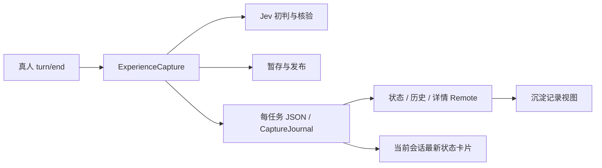

# feat: 自动沉淀判定历史与可观测性

2026-10-25。状态：**H1–H4 已实现，生产样本校准另行验证**。本功能保持当前 Desktop 自动采集关闭；验证使用受控模型与临时 Wiki，没有向真实 Wiki 写入合成经验。

## 1. 用户目标与范围

用户完成一轮软件工程任务后，能在插件中回答：有没有触发自动采集、何时调用 Jev、判断了什么、为什么通过或未通过、最后有没有写入，以及依据来自哪里。

首版提供“沉淀记录”入口、当前会话的分页历史、单条任务详情和明确的采集状态。查看其他会话时先在宿主切换会话。读取历史时，采集器可以保持关闭。

本次不扩展全局会话枚举、批量重判、手动批准发布、导出原始会话、自动清理历史或通知；不调整现有判定阈值、模型版本、writer 路由和发布策略。历史浏览不会继续父会话或发起模型调用。

## 2. 已核实的现状

| 位置 | 当前行为 | 本功能需要补齐 |
|---|---|---|
| [server/index.ts](../packages/dsh-memory-wiki/src/server/index.ts) | `capture.enabled` 默认关闭；启用后注入 `llm/sessionQuery`，监听 `session/event` | 明确区分关闭、等待服务、就绪与不可用；关闭时仍可读历史 |
| [capture/experience.ts](../packages/dsh-memory-wiki/src/server/capture/experience.ts) | 真人 `turn/end` 登记任务；一个 job 一个 JSON；阶段更新覆盖 `phase/reason/updatedAt` | 保留每次阶段变化、两次判定及恢复尝试 |
| [capture/jev.ts](../packages/dsh-memory-wiki/src/server/capture/jev.ts) | 两次 System One 调用；只向调用方返回决定、原因和模型 | 保留结构化答案、实际使用的阈值、用量和本地调用耗时 |
| [CaptureStatus.tsx](../packages/dsh-memory-wiki/src/client/CaptureStatus.tsx) | 展示当前会话最新一条任务和有限证据摘录 | 从同一份历史投影最新卡片，并可进入对应历史详情 |
| [shared/contracts.ts](../packages/dsh-memory-wiki/src/shared/contracts.ts) | `CaptureView` 无时间线、判定结果或历史查询契约 | 增加列表、详情、状态 DTO，并同步生成 Remote |

当前 Desktop 配置未配置 `capture`，默认数据目录也不存在。此事实只作为本轮设计的基线，界面实现后必须通过状态接口实时获取，不能写死“已启用”。

触发点是一整轮真人任务的 `turn/end`。原始工具调用、结果和文件改动是证据的一部分。子代理任务不进入这条采集链；工程调研、配置和失败尝试也可能产生有价值的经验。

## 3. 结果语义

**初判通过、核验通过、写入成功分别记录。** 模型返回的概率是判定输入，不作为内容正确率展示。系统错误单独展示，不能解释成经验没有价值。

| 事实 | 用户看到的结果 | 记录要点 |
|---|---|---|
| 初判决定为 `prepare` | 初判通过 | 经验类型、各问题答案、满足的条件 |
| 核验决定为 `publish` | 核验通过 | 逐条断言、原始证据、重复/冲突关系 |
| `ingested` | 已沉淀 | 发布成功时间、页面与内容版本 |
| `skipped` | 无需沉淀 | 无长期价值、非工程任务或已有知识覆盖等具体原因 |
| `deferred` | 待补证据／存在冲突 | 未满足的具体条件；不能标成调用失败 |
| `failed` | 执行失败 | 失败阶段、错误类别和脱敏原因；已有通过记录继续可见 |
| `needs_attention` | 发布需处理 | 并发修改或部分发布情况，保留已有恢复清单 |
| 进行中 | 等待／初判／整理／核验／发布中 | 开始时间与当前阶段，不预判结果 |
| 调用开始后进程中断，缺少结束记录 | 此次调用结果未知 | 不能推断“未发出请求”“模型拒绝”或“未产生费用” |

判定仍使用当前 rubric：Choice 所选概率至少 0.95 且 confidence 至少 0.90；初判 Noul 门槛为 0.90；核验完整性和 outcome 门槛为 0.95。具体门槛来自执行判定的同一份规则定义，不能在 UI 或日志中再维护一份数值。

## 4. 界面与交互

顶栏增加文字入口 **沉淀记录**。打开后进入插件内独立的历史视图，显式替换本插件内容区；“返回图谱”恢复原来的图谱、缩放、选择和详情状态。历史视图不作为错误遮罩叠在画布上，也不为它重新创建 Sigma 实例。

实现时让图谱与历史视图状态分开保存，为 `EvidenceGraph` 增加可见状态。隐藏时保留实例，暂停焦点计算，尺寸为零时不调用 Sigma 的 `resize`；返回可见状态后调用公开 `resize/refresh`，恢复前不重置相机。历史视图内打开沉淀页面时，先返回图谱，再沿用 `openPage(pageId)` 读取当前页面；页面已变更时标注“当前内容”，不能冒充当时发布版本。

普通“返回图谱”只恢复尺寸，不调用 `fit()` 或重新居中；从记录打开页面则在图谱可见、尺寸已刷新后执行选中与居中。历史请求错误使用自己的状态，不写入 `graphError`；普通返回不额外触发整库重读。低于 700px 继续采用现有详情阅读视图，节点居中只适用于桌面可见画布。

```text
沉淀记录                                    返回图谱
自动采集：未启用          当前会话：<会话>   刷新记录
状态：全部 / 处理中 / 已沉淀 / 无需沉淀 / 待补证据 / 异常

登记时间        任务摘要             最终状态          查看详情
<本地时间>      修复图谱刷新故障      已沉淀            →
<本地时间>      调整节点定位          待补证据          →
                                                   加载更多

详情：任务与原始轮次、阶段时间线、两次判定、证据与改动
```

上例只是布局示意，不代表已存在这些真实判定。

- 列表默认按会话原始轮次倒序；显示登记时间、任务摘要、轮次、最终状态和简短原因。初判/核验标签在展开后查看，不把所有概率挤进列表。
- 任务摘要从已脱敏的真人输入提取首段，列表最多 120 字，明确省略；不额外调用模型生成摘要。
- 单条详情中，时间线从早到晚。每次判定展开时才加载这一 attempt 的问题、选项、模型答案、概率、阈值、通过情况和未满足条件；核验的断言关联证据 seq。展开失败可在该条内重试，已完成判定不重复轮询全文。
- 显示模型固定版本、rubric 版本、证据哈希、规则哈希及核验 patchHash。哈希短显、可复制完整值。
- 时间以 UTC ISO 存储，按浏览器本地时区显示日期、时间和时区；登记时间与判定时间分别命名。
- 未绑定会话：显示采集状态，提示在宿主打开会话后查看该会话历史。已关闭且有历史：历史照常可读。已就绪但无历史：提示“尚无本会话采集记录”，不显示成功或失败。
- 列表/详情加载失败显示在历史视图内，保留已加载内容和刷新入口。部分文件不可读时明确显示历史不完整，不能伪装成零条。
- 切换会话立即清除上一会话列表、详情和游标；晚到的旧请求不能落入新会话。隐藏视图不轮询。
- 历史可见且页面前台时每 3 秒刷新采集状态和首屏；已有翻页结果不静默重排，显示“有更新，刷新记录”。进行中详情同期刷新。页面隐藏或离开历史时停止；手动刷新始终可用。
- 桌面列表与详情并排；低于 700px 时列表和详情逐级进入、可返回。键盘可操作入口、筛选、详情和返回；状态变化使用克制的 `aria-live`。

## 5. 数据与唯一权威

沿用 `$DSH_HOME/storages/memory-wiki-auto-capture/<wikiRootHash>/<jobId>.json`，保留现有 jobId、证据、发布清单和锁。增加 `capture/journal.ts`，集中负责格式读取、逻辑追加、投影和查询。它有实际责任：避免采集器、最新卡片和历史接口分别解释同一份数据。



内部格式升为 `schemaVersion: 2`，在现有任务中增加：

```ts
type CaptureHistoryFields = {
  schemaVersion: 2
  registeredAt?: string              // 新任务的真实登记时间；旧记录不补造
  historyCoverage: 'complete' | 'legacy_snapshot'
  events: CaptureEvent[]             // 按 seq 单调递增，逻辑追加
  judgments: JudgmentRecord[]        // 各次调用的请求与结果快照
}

type JudgmentStage = 'assessment' | 'verification'

type JudgmentRecord = {
  id: string
  stage: JudgmentStage
  attempt: number
  model: string
  rubricVersion: string
  requestHash: string
  evidenceHash: string
  patchHash?: string
  questions: JudgmentQuestion[]       // 当次实际问题与候选项定义
  result?: {
    kind: 'decision'
    answers: JudgmentAnswer[]        // 按问题 ID 对应有效结构化答案
    gateResults: GateResult[]        // 引用问题 ID，记录实际规则及是否满足
    disposition: 'prepare' | 'publish' | 'skipped' | 'deferred'
    reasonCode: string
    reason: string
    usage?: { inputTokens: number | null; outputTokens: number | null }
    requestId?: string
  } | {
    kind: 'error'
    error: { category: string; message: string; httpStatus?: number }
  }
}
```

`CaptureEvent` 是判别联合，公共字段为 `seq/at/kind`。首版事件包括 `registered`、`phase_changed`、`judgment_started`、`judgment_finished`、`judgment_failed`、`judgment_interrupted`、`recovery_started`、`publication_finished`、`publication_interrupted`、`operation_failed`、`legacy_snapshot`。判定事件只引用 judgment ID，不复制完整答案；结束事件可附本地测量的 durationMs。

**生命周期以 events 为权威，judgments 只承载请求与结果快照。** 对外的 attempt 状态、startedAt、finishedAt 和 durationMs 从事件投影，不在 judgments 再保存一份。每个 judgment ID 必须有一个 started 事件，最多有一个结束事件；finished 必须对应 decision 结果，failed 对应 error，interrupted 不得携带伪造结果。journal 在同次原子写入内维护并校验这些对应关系。

时间线 seq 是 job 内部序号，证据引用则是原会话事件 seq，字段和界面标签分别命名，不能混用。旧记录的登记时间显示未知；旧 model 只能标为旧快照模型，不能据此补出两次调用。

`JudgmentQuestion` 区分 Choice 和 Noul，保存当次实际 question 文本及选项；`JudgmentAnswer` 中 Choice 保存所选项、全部 probabilities 和 confidence，Noul 保存数值。`GateResult` 保存程序实际执行的门槛、运算与结果，引用 question ID；证据缺口、任务 outcome 与重复/冲突等程序条件也要有明确 code。终态原因由这些结果得出，UI 只做翻译和排版。

当前 `phase/reason/updatedAt` 保留为运行与列表需要的摘要，由唯一的 journal 更新方法和对应事件一起原子写入。摘要不是另一套事实来源。已结束的判定结果保持不变；恢复调用新增 attempt，不覆盖上一条。当前状态卡片和历史列表均从 journal 投影，现有内存 Map 不再作为历史查询权威。

列表读取摘要，详情按需读取证据。证据预览沿用最多 12 条、每条 1,000 字符的限制并显式标注截断；完整证据仍保存在本地任务文件。判定问题与答案存一次、按需展开。用量只显示服务实际返回的 token 数，null 或缺失显示“未提供”，不能转为 0；首版不估算费用。

完整性分三层：job 的 `historyCoverage` 表示从登记起记录，或仅有旧快照；查询的 `readCompleteness: complete/partial` 表示本次可确定属于查询范围的记录是否均可读取，未知归属的损坏文件按可能缺失报告 partial；history availability 表示存储整体可读、降级或不可用。旧快照可完整读取，不因此判为存储降级；nextCursor 表示尚有分页，与缺失记录无关。

## 6. 写入顺序、异常与恢复

1. 新任务在现有 `register.lock` 内登记，保存 `registered` 事件及冻结证据，随后进入既有 worker 队列。
2. worker 持有现有 `<jobId>.worker.lock`，重读磁盘最新记录。开始 Jev 逻辑调用前先持久化 `judgment_started` 与 started attempt；写入失败则不执行该调用。
3. Jev 返回后，在推进后续阶段前持久化规范化答案、用量、规则结果和最终决定。准备文件与最终发布仍遵循原有验证顺序。
4. `JevJudge` 用同一份请求定义生成实际 questions 与审计快照，用同一个判定函数产生 gateResults 与 disposition。记录功能不能引入第二份 rubric 或第二条模型调用。
5. 使用已安装 SDK 可提供的结构化结果；requestId 可通过其受支持的 response 接口取得，只保留 ID 与必要 HTTP status，不保存完整 headers。`durationMs` 用单调时钟度量本地整个 SDK 调用耗时，包含 SDK 内部重试，不能称为服务端计算耗时。
6. SDK 现有 `maxRetries: 1` 不变。attempt 表示采集流水线的一次逻辑调用，不代表一次 HTTP 请求；当前版本不声称逐次记录 SDK 内部网络重试。
7. 调用报错记录阶段与脱敏错误类别：配置、网络/超时、HTTP、返回格式、writer/校验、文件发布等。无效模型输出记录字段校验错误，不能保存任意完整响应体冒充有效答案。worker 锁未取得时更新会话运行诊断，不能在未持锁时改写 job，也不能把另一 worker 仍在执行的任务标成失败。
8. 重启取得 worker 锁后，旧 started attempt 若缺少结束记录，追加 interrupted 事件并标“结果未知”。仍按现有恢复策略决定是否重新运行；新调用使用新 attempt。停止应用时的中断也要保留，不能记成“经验未通过”。
9. 原有 verifiedPatchHash 和发布清单仍决定恢复发布资格。发布开始、成功、冲突或失败记入同一时间线；“核验通过但发布失败”保持可辨认。

每次更新继续使用现有 `atomicWrite`，事件、判定与摘要在同一 job JSON 中一起替换，不增加第二份 JSONL、数据库或独立审计写入链。读取不会看到半个 JSON；跨进程读取从磁盘获得最新已提交版本。写入失败必须阻止后续尚未开始的副作用。若副作用已经发生而结果落盘失败，显示/恢复为结果未知，依据既有发布清单核对，不能伪造成功记录。

取证失败发生在 job 注册之前时，还没有可归属的判定。复用现有 `watched/<sessionHash>.json` 增加 `lastIssue`，保存该会话最近一次运行诊断：时间、阶段（取证/worker 锁/记录写入）、turn/end seq 或 jobId、code 与脱敏原因；状态接口只返回该已解析会话的诊断。取证失败显示“未进入 Jev”，对应操作成功后清除当前错误，不能补造过去的判定。若连诊断文件也无法写入，服务保留内存诊断并标明“尚未持久化”，不能声称重启后仍能还原该次错误。

## 7. 历史兼容与数据读取

旧记录没有阶段时间和完整概率，不能从最新 `updatedAt` 推算过去。只提供一个明确标为 `legacy_snapshot` 的旧状态快照；保留旧的 phase/reason/updatedAt，`registeredAt` 留空。

兼容范围仅为无 schemaVersion 的现有任务文件：journal 先将其纯规范化成统一 V2 内部模型，再走同一套投影与查询。读取不改写文件，也不触发恢复；第一次获锁写入时原子升级为 V2。新写入只接受 V2。未来旧文件已迁移且旧写入器已停用后，可移除这一个历史格式导入器；不保留旧查询业务路径或另一套判定逻辑。

文件名与 jobId 必须一致；拒绝路径逃逸、未知未来 schema 和无效事件序列。损坏记录保留原文件，服务报告历史降级并隔离该记录。由于无法证明损坏任务没有未恢复发布，已启用的采集器进入 blocked，停止新的采集处理；关闭时仍显示 disabled，同时报告历史降级。可读历史和图谱仍可打开，不自动删除或修复原文件。新字段不会修改原证据 contentHash 的计算对象。

## 8. Remote 与权限

首版增加四个只读方法，统一在 [shared/contracts.ts](../packages/dsh-memory-wiki/src/shared/contracts.ts) 定义类型，再由 `@Remote` 和现有生成器产生 codec。单次判定单独按 ID 加载，避免反复恢复积累的所有答案都进入事件分页响应。

| 方法 | 输入 | 输出 |
|---|---|---|
| `captureStatus` | `{ sessionId?: string }` | collector：`disabled/starting/ready/blocked`；history：`readable/degraded/unavailable`；安全的 reasonCode；传入有效会话时才附该会话 lastIssue |
| `captureHistory` | `{ sessionId, cursor?, limit?, status? }` | 任务摘要、nextCursor、readCompleteness |
| `captureRecord` | `{ sessionId, jobId, afterEventSeq?, limit? }` | 任务与 origin、事件页、该页引用的判定摘要、证据预览、改动摘要和发布版本 |
| `captureJudgment` | `{ sessionId, jobId, judgmentId }` | 单个判定的完整问题/答案/门槛，以及从事件投影的状态和调用时间 |

具体约束：

- `captureStatus({})` 只返回不含会话内容的配置/依赖状态；不返回凭据、绝对数据路径或其他会话的诊断。
- ready 表示本地配置、宿主依赖和存储初始化成功，不代表远端 Jev 已可用或已发生判定；不通过额外模型请求做状态探活。最近真实调用的结果由历史单独表达。
- 历史列表和详情先经过宿主会话解析，再验证 job.origin.sessionId 与该会话一致。jobId 不是授权凭据。未知 job 与跨会话 job 返回相同的不可读取错误。
- 单次判定读取还须验证 judgmentId 属于该 job；事件分页只带摘要，只有 `captureJudgment` 返回所选一次调用的答案，不能带出整个 judgments 数组。
- 现有 `MemoryWikiAdapter.resolve()` 只证明 ID 在 `ctx.sessions` 存在，没有显式调用者 ACL。V1沿用当前本机已认证 Desktop 的信任范围，不声称具备多用户权限隔离；不增加全局 job 查询。若部署目标扩展到多用户，必须先接入宿主可验证的主体/会话授权。
- 抽出并复用现有会话解析方法，历史读取不通过 `getView()` 顺带创建选择草稿或改变 revision。客户端不提交 principal、workspace 路径或任意文件路径。
- 列表默认 20 条、上限 50；事件默认 50 条、上限 100。非整数、负数、超限、未知筛选值及无效游标显式拒绝，服务端执行范围校验。
- `status` 省略表示全部；枚举为 processing、ingested、skipped、deferred、error。服务端在分页前映射：processing 为 queued/judging/preparing/verifying/publishing，error 为 failed/needs_attention，其余对应同名 phase。UI 复用这些类别，游标绑定类别，不能先取一页后在客户端过滤。
- 列表按不可变的 `(turnEndSeq, jobId)` 倒序 keyset 分页；游标绑定 session、筛选、首屏 turnEndSeq 上界及最后排序键。事件按 job 内 seq 正序分页。切换会话/筛选必须清空游标。
- 列表是实时历史读取，不承诺跨请求事务快照。后来补登到已翻过范围的旧轮次，及状态筛选发生变化的条目，通过刷新首屏重新呈现；当前详情读取其最新已提交版本。UI 不静默把已有行移动到别的位置。
- 状态接口、历史查询不会构造或启动 `ExperienceCapture.recover()`。journal 的只读访问和采集器生命周期分开；关闭采集后历史仍可用，无记录目录按空历史处理。
- 同步扩展 `remote-smoke.ts` facade、`RemoteClient`、`MemoryWikiSource`、`remote-source.ts`、测试 fixture 和生成声明。输入 strict codec 与输出投影都必须核验，生成文件由构建生成，不手改。

## 9. 实施顺序与文件落点

| 步骤 | 改动 | 可检查结果 |
|---|---|---|
| H1 数据记录 | 新增 `src/server/capture/journal.ts`；修改 `types.ts/experience.ts/jev.ts` | 真实 pipeline seam 的受控测试能读到初判、核验及错误历史；已完成判定不被覆盖 |
| H2 只读接口 | 修改 `shared/contracts.ts`、`server/index.ts`、会话解析 seam 和客户端 source/Remote facade；状态 wiring 放在 `capture/host.ts` 及服务生命周期 | 关闭采集仍能查询历史；分页与会话隔离有效；生成 codec 与调用方一致 |
| H3 历史视图 | 新增 `src/client/CaptureHistory.tsx`；修改 `MemoryPanel.tsx/CaptureStatus.tsx/EvidenceGraph.tsx/memory-panel.css` | 按会话查看列表和详情，当前卡片可定位 job；隐藏图谱不触发零尺寸 resize，返回保留镜头与详情 |
| H4 联调与交付 | 新增 journal/Remote 测试，扩展 Jev/pipeline 测试；更新 README、DESIGN 和 CODEMAP，重建生产产物 | 实际 DSH 中查看真实产生的历史，确认关闭/空历史/失败状态不混淆 |

先在隔离 DSH profile、临时 Wiki 和受控模型中验收。实现交付时默认关闭自动采集；当前 Desktop 的启用与真实 Wiki 写入属于后续单独操作，不能因查看历史或装载界面而自动发生。

## 10. 验收标准

| 场景 | 必须观察到的结果 |
|---|---|
| 初判与核验通过、发布成功 | 一个 job；两次判定分别存在；阶段时间与发布页对应；列表为已沉淀 |
| 初判无价值／低置信 | skipped/deferred 与实际 gate 一致；没有 writer 或第二次 Jev 调用 |
| 核验重复／冲突／断言不足 | 初判通过仍保留；核验未通过原因可展开；没有发布 |
| Jev HTTP/超时/错误模型版本/非法答案 | 执行失败与阶段明确；不是“无价值”；有效旧答案不被覆盖 |
| writer、lint 或发布失败 | 能定位失败阶段；已经通过的判定仍可追溯；发布恢复遵循既有清单 |
| started 后进程退出，再恢复 | 旧调用结果未知，新 attempt 独立；不捏造响应、耗时或用量 |
| 收到事件但取证失败，稍后补登 | 最近取证错误标记未进入 Jev；补登不重复 job |
| 禁用采集、有旧历史 | 能查历史；零新增模型调用、零 Wiki 写入、零任务恢复 |
| 关闭／服务等待／配置错误／无记录 | 界面分别表达，各自有证据；没有默认“运行正常” |
| 旧记录／损坏文件／未来 schema | 旧快照明确不完整；损坏与未知格式显式报告并阻止新采集，原数据保留，可读历史不受阻 |
| 分页、状态变化和跨会话晚到响应 | 排序键稳定、游标受限；刷新可见补登；旧响应不串到新会话 |
| 伪造 sessionId/jobId、额外输入、非法分页 | 拒绝未知会话与跨会话 job；strict codec 和服务端范围检查都生效 |
| 凭据出现在错误或证据中 | 已知凭据与敏感字段经过现有脱敏；列表只包含允许字段；不持久化 headers 或任意响应体 |
| 历史视图桌面/390px、返回图谱 | 入口与筛选可用；无横向溢出；返回后镜头、选中节点、详情及 WebGL 正常 |

验证按 H1→H4 执行：先定点测试，再 host/client 类型检查、生成构建，最后一次完整测试与浏览器交互。受控模型通过只证明记录链路；真实模型判定质量、生产经验内容质量需另用样本评估，不能由这项 feat 推导。

## 11. 关键取舍与限制

- 每个 job JSON 继续是本地事实权威；逻辑追加不等于防篡改审计日志，不提供第三方存证承诺。
- 本地“准备调用已落盘”与模型服务实际接收之间仍有不可观测窗口；用结果未知表达，不新增网络重试策略来掩盖。
- 日志记录现有 rubric 的结果，不校准中文样本的正确率；语义重复/冲突识别的覆盖限制仍然存在。
- 历史会随使用增长。首版保留现有本地文件规模模型，只向客户端分页返回摘要，不自动删除；若真实数据证明启动或扫描成本成为问题，再另行设计索引/保留策略。
- 当前会话存在性检查与多用户授权是不同能力。V1 的本机 Desktop 范围必须在 README 中写明。

设计完成条件：上述目标、状态、持久化、恢复、兼容、接口、交互和验收已锁定为同一首版范围；后续实现不再以“通过/不通过”单一布尔值替代这里的阶段事实。

## 12. 实现核验记录（2026-10-25）

- 已按本方案实现 journal、两阶段判定记录、四个生成 Remote 和历史界面；本机 Desktop 已重载 Memory Wiki，状态明确为“未启用”，当前会话暂无采集历史。
- 专项测试覆盖旧快照、未知格式、损坏文件、会话归属、分页、恢复中断、记录写入失败、额外字段隔离和常见 provider 环境变量凭据脱敏。
- 临时 Wiki 集成经过真实 System One 协议的受控 HTTP 响应、两次 Jev 记录、writer 暂存和发布，再通过关闭采集的实际 Cordis 服务读取历史。Wiki index/lint 命令在该测试中为受控脚本，不据此声称真实 Wiki schema 验证已完成。
- 浏览器使用实际生产 client bundle 与 journal-backed RPC，验证分页、判定答案和门槛、null 用量、筛选、切换会话、390px、返回图谱保留相机与实例；未出现相关控制台错误。Browser 插件当前不可用，使用已有 Playwright/Chrome。
- 本机 Desktop 空历史由真实新 Remote 返回；合成历史界面验证在隔离浏览器完成，没有把测试任务写进 Desktop 数据目录。

### 最终验证与双轴复核

- 当前工作区：构建、host/client 类型检查、160/160 项测试通过。
- 本 feat 隔离树：构建、host/client 类型检查、158/158 项测试通过；不包含此前未提交的两项图谱生命周期回归测试。
- Standards：凭据字段识别、watched 身份校验、磁盘额外字段投影及发布部分结果不可知的问题已修正；对应专项检查通过。
- Spec：分页筛选、短列表轮询不重排、长时间线持续更新、当前页面版本读取、SDK 耗时和非判定错误分类已修正；受控浏览器验证通过。
- 复核与测试均不证明真实中文经验的模型判定质量。当前 Desktop 自动采集仍关闭。
